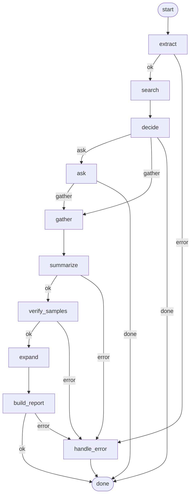

# Chop the Song

[](https://github.com/mttpzz/chopthesong/actions/workflows/ci.yml)
[](LICENSE)

Name a song, and get a report on it: genres, a short lyrics summary, the samples it
uses, and links to listen or read further. Built on free and open data sources.

## What it is

You describe a track in plain words ("Bohemian Rhapsody", "the Fatboy Slim one with
the piano"). The app extracts a title and an artist, searches MusicBrainz, and shows
the candidate versions when the match is not obvious. Once a recording is chosen, it
builds a report with:

- **Genres** from Deezer, merged and de-duplicated.
- **Lyrics summary**: a short topic, a summary and an "artist's view" generated from
  the lyrics returned by LRCLIB.
- **Samples**, explored level by level: each sample can have its own samples, up to
  `REPORT_DEPTH` rounds (0 disables, 3 is the maximum).
- **Spotify links** for the track, artist, album and samples, when client credentials
  are configured.
- **Wikipedia** as the source for sample evidence and background.

A **Shazam** link sits under the search form for the case where you hear a song and
do not know its name: identify it there, then type the title and artist here.

Under the hood, a LangGraph state machine runs the resolution as explicit nodes,
pauses with `interrupt()` when a human choice is needed, and resumes from the same
thread. Every step returns either a result or a single user-facing error, never a
partial report.

## Demo

The public app runs on Streamlit Community Cloud:

<https://chopthesong.streamlit.app/>

No image or GIF is included yet.

## How it works



| Node | What it does |
| --- | --- |
| `extract` | Turns the free-text request into a title and an artist with Groq (`ChatGroq`) and a Pydantic schema. |
| `search` | Queries MusicBrainz and keeps up to 25 candidate recordings. |
| `decide` | Scores candidates with RapidFuzz and canonicalizes them to one track per title and primary artist, keeping the best-documented edition and dropping compilations. |
| `ask` | Pauses the graph with `interrupt()` when the match is ambiguous, and resumes with the version the user picks. |
| `gather` | Fetches genres (Deezer), lyrics (LRCLIB) and an encyclopedia extract (Wikipedia) through LangChain tools; a dead source returns an empty value instead of breaking the run. |
| `summarize` | Asks the LLM for a short lyrics summary, the topic and the artist's view. |
| `verify_samples` | Accepts a sample only when the Wikipedia evidence supports it. |
| `expand` | Follows the samples' own samples, one round at a time, up to `REPORT_DEPTH`. |
| `build_report` | Assembles the final report: track, genres, summary, samples, sources and notes. |
| `handle_error` | Ends the run with one user-facing message for rate limits, provider errors or an invalid key. |

## Tech stack

Versions come from `pyproject.toml`, `uv.lock`, `android/` and `.github/workflows/ci.yml`.
The data sources and the Shazam link are external services, not dependencies. The
development assistants are listed separately under [Development tools](#development-tools).

| Category | Technology | Use in the project |
| --- | --- | --- |
| Languages | Python 3.12 | Application, scripts and tests (`requires-python = ">=3.12,<3.13"`, `.python-version`). |
| | Kotlin | The single Android activity (`MainActivity.kt`). |
| | TOML | `pyproject.toml`, `.streamlit/config.toml`, `android/gradle/libs.versions.toml`. |
| | YAML | The CI workflow (`.github/workflows/ci.yml`). |
| Backend and graph | LangGraph 1.2.19 | The resolve graph, state, conditional edges and human-in-the-loop `interrupt()`. |
| | LangChain Core 1.7.3 | `BaseTool`/`@tool` definitions and message types. |
| | Pydantic 2.14.2 | Report and extraction schemas. |
| | Pydantic Settings 2.16.2 | Environment and `.env` configuration (`src/config.py`). |
| | HTTPX 0.28.1 | Async HTTP client for every API call. |
| | SQLite (standard library) | On-disk JSON cache for API responses under `data/cache/`. |
| | RapidFuzz 3.14.6 | Title and artist similarity scoring in `src/matching.py`. |
| LLM and observability | Groq via `ChatGroq` (`langchain-groq` 1.1.3, `groq` 0.37.1) | Extraction and lyrics summary on the free tier. |
| | Langfuse 5.2.0 | Optional metadata-only tracing (`src/tracing.py`); no prompts or song text. |
| Interface | Streamlit 1.66.1 | The web UI in `app.py`. |
| | CSS and SVG | The full-page opening animation, defined inline in `app.py`. |
| Android | Kotlin | `MainActivity.kt` hosts a single `WebView`. |
| | Android Gradle Plugin 9.5.1 | Builds the app module. |
| | Gradle 9.6.0 | Wrapper distribution (`gradle-wrapper.properties`). |
| | Android SDK 37 | `compileSdk` and `targetSdk` 37, `minSdk` 24, Java 17. |
| | WebView | Loads the public app; only the `INTERNET` permission is requested. |
| | Adaptive icon | Launcher icon in `mipmap-anydpi-v26/`. |
| Quality | pytest 9.2.0 | Test suite. |
| | pytest-asyncio 1.4.1.post1 | Async tests, `asyncio_mode = "auto"`. |
| | respx 0.23.1 | Mocked HTTP in tests: no real API calls. |
| | ruff 0.17.3 | Linting, 100-character lines, Python 3.12 target. |
| Project and CI | uv | Dependency resolution (`uv.lock`), `uv sync` and `uv run`. |
| | GitHub Actions | CI on pushes and pull requests to `main`. |
| | `actions/checkout@v7`, `astral-sh/setup-uv@v7` | Checkout and Python 3.12 setup in CI. |
| Hosting | Streamlit Community Cloud | Public hosting from the GitHub repository. |
| | MIT License | The project licence. |
| Data sources | MusicBrainz API | Recording search and canonical track metadata. |
| | Deezer API | Genres and album data. |
| | LRCLIB | Plain lyrics. |
| | Wikipedia API | Song background and sample evidence. |
| | Spotify Web API | Optional links to open a track in Spotify. |
| | Shazam | Outbound link only, for identifying an unknown song. |

## Development tools

The code was written with two assistants:

- **Claude Code with Claude Haiku 5.5**
- **opencode with DeepSeek V4.1 Flash**

The workflow was step-based: each step had a written specification, the change was
verified against it, and the owner reviewed the result before committing.

## Local run

Requirements: Python 3.12 and [uv](https://docs.astral.sh/uv/).

```powershell
uv sync --python 3.12
Copy-Item .env.example .env
```

On a POSIX shell the second line is `cp .env.example .env`. Then fill in `.env`:

| Variable | Required | Purpose |
| --- | --- | --- |
| `USER_AGENT` | yes | Descriptive MusicBrainz User-Agent with a real contact. |
| `GROQ_API_KEY` | yes | Builds the LLM client. |
| `GROQ_MODEL` | no | Model id; defaults to the value in `src/config.py`. |
| `DATA_DIR` | no | Cache root, `data` by default. |
| `CACHE_TTL_SECONDS` | no | Cache lifetime, 30 days by default. |
| `REPORT_DEPTH` | no | Sample expansion rounds, `2` by default (0–3). |
| `LANGFUSE_PUBLIC_KEY`, `LANGFUSE_SECRET_KEY` | no | Enable tracing only when both are set. |
| `LANGFUSE_HOST` | no | Langfuse endpoint. |
| `SPOTIFY_CLIENT_ID`, `SPOTIFY_CLIENT_SECRET` | no | Enable Spotify links only when both are set. Client credentials, no user login. |

Start the app:

```powershell
uv run streamlit run app.py
```

## Tests and quality

```powershell
uv run pytest
uv run ruff check .
```

The suite has 201 tests. Tests use fake HTTP clients and fake LLM objects: they make
no real calls and need no keys.

## Evaluation

`scripts/evaluate.py` scores the resolver on a fixed dataset of 12 tracks whose
MusicBrainz IDs are confirmed by hand. It calls the same service functions the UI
uses, one track at a time, and writes metrics to `data/eval/` (JSON and Markdown).
Output contains counts, outcomes and identifiers only: no query, song or
encyclopedia text.

```powershell
uv run python scripts/evaluate.py --dry-run   # validate the dataset, no network
uv run python scripts/evaluate.py             # full run, writes data/eval/
```

Latest results: **2026-11-16**, `REPORT_DEPTH=2`, 12 of 12 tracks. The first full run
completed 11 tracks; `stronger` hit the Groq free-tier daily limit and was re-run on the same day
after the quota reset. Dataset version `sha256:470ba6a88b6dbfb26c40113e11286b4d80d97fae1681233d68600e8ce6b3adc8`.

| id | outcome | Wikipedia samples | Error |
| --- | --- | --- | --- |
| bohemian-rhapsody | resolved | 0 | - |
| praise-you | resolved | 8 | - |
| stronger | resolved | 0 | - |
| around-the-world | resolved | 0 | - |
| smells-like-teen-spirit | resolved | 0 | - |
| rappers-delight | resolved | 2 | - |
| walk-this-way | resolved | 0 | - |
| amen-brother | resolved | 0 | - |
| billie-jean | resolved | 0 | - |
| gangstas-paradise | resolved | 1 | - |
| hey-ya | resolved | 0 | - |
| blue-monday | resolved | 1 | - |

Totals, with the same formulas the script uses:

- Resolution OK: 12/12 (100.0%)
- Has genres: 12/12 (100.0%)
- Has summary: 12/12 (100.0%)
- Summary status: ok 12
- MB samples recall (mean): - (the dataset lists no expected sample MBIDs)
- Errors 0, ambiguous 0, not found 0, cancelled 0, wrong track 0, unverified 0

## Deploy

The app runs on [Streamlit Community Cloud](https://share.streamlit.io), which serves
it for free from a public GitHub repository. The server installs `requirements.txt`,
generated with `uv export --no-dev --no-hashes --format requirements-txt`; it does not
install the local package, because `app.py` imports `src` from the repository root.

Add the configuration in the app's **Settings → Secrets** page, in TOML format. Never
commit these values:

| Name | Required | Notes |
| --- | --- | --- |
| `GROQ_API_KEY` | yes | Secret. Never commit it. |
| `GROQ_MODEL` | no | Defaults to the model configured in `config.py`. |
| `USER_AGENT` | yes | A descriptive MusicBrainz User-Agent with a real contact. |
| `LANGFUSE_PUBLIC_KEY` | no | Leave empty to disable tracing. |
| `LANGFUSE_SECRET_KEY` | no | Leave empty to disable tracing. |
| `LANGFUSE_HOST` | no | Defaults to `https://cloud.langfuse.com`. |
| `SPOTIFY_CLIENT_ID` | no | Leave empty to hide Spotify links. |
| `SPOTIFY_CLIENT_SECRET` | no | Leave empty to hide Spotify links. |

Top-level secrets are also exposed as environment variables, which is how
`config.py` reads them. The server filesystem is ephemeral: the `data/` HTTP cache is
lost on restart, so the first search after a restart is slower.

## Android

`android/` contains a single-screen app: a `WebView` that loads the public Streamlit
app. It holds no API keys and does no search itself. It requests only the `INTERNET`
permission. There is no signing configuration and no keystore.

```powershell
cd android
./gradlew assembleDebug
```

The debug APK is written under `android/app/build/outputs/apk/debug/`.

## Repository structure

```
app.py                  # Streamlit UI and the opening animation
src/
  config.py             # settings from the environment and .env
  http.py               # async HTTP client, disk cache and rate limiter
  llm.py                # ChatGroq client and typed errors
  matching.py           # scoring and canonicalization
  musicbrainz.py        # MusicBrainz client
  resolver.py           # LangGraph graph and human-in-the-loop
  schemas.py            # Pydantic models
  service.py            # start and resume a search
  spotify.py            # Spotify Web API client
  tools.py              # Deezer, LRCLIB and Wikipedia tools
  tracing.py            # optional Langfuse tracing
scripts/evaluate.py     # evaluation runner
eval/tracks.json        # fixed evaluation dataset
tests/                  # pytest suite
android/                # Kotlin WebView app
.streamlit/config.toml  # dark theme with a deep red accent
.github/workflows/ci.yml  # lint and test on every push
```

## Known limitations

- Free sources have incomplete coverage: not every track has genres, lyrics or a
  documented sample list, and the report shows only what those sources return.
- Groq runs on the free tier, so the daily quota can be hit; a 429 is reported to the
  user as a retry message, with no fallback provider.
- Spotify is optional and rate-limited. Without client credentials, the report simply
  has no Spotify links.
- Wikipedia samples are accepted only with evidence, and expansion stops at
  `REPORT_DEPTH` rounds; deeper chains are not followed.
- Shazam is only an external link. The app does not record audio or identify songs.
- The Streamlit Community Cloud app pauses after a period without traffic, and the
  first visit afterwards is slower.
- Human-in-the-loop state is in memory (`InMemorySaver`): a server restart cancels
  pending choices.

## License and credits

Released under the [MIT License](LICENSE). Copyright (c) 2026 Matteo Pozzi.

Thanks to the people behind the free services this project relies on:
[MusicBrainz](https://musicbrainz.org), [Deezer](https://www.deezer.com),
[LRCLIB](https://lrclib.net), [Wikipedia](https://www.wikipedia.org),
[Spotify](https://developer.spotify.com) and [Shazam](https://www.shazam.com).
